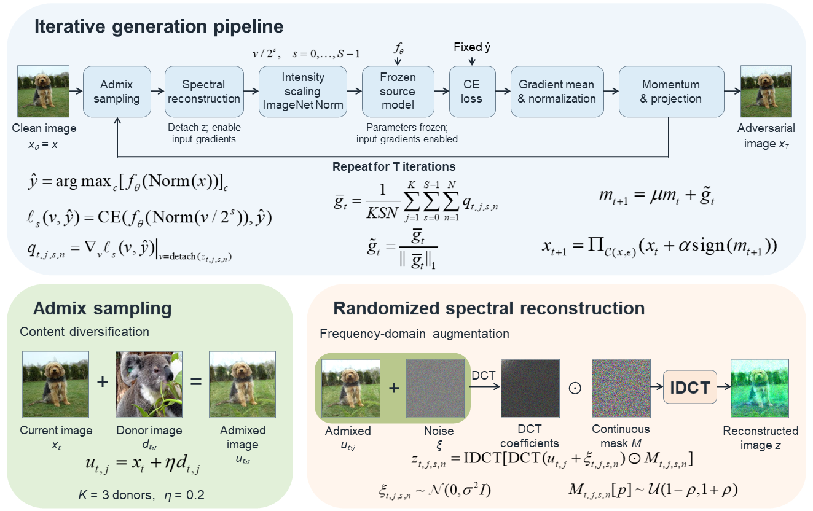

# MASS

Implementation accompanying **MASS: Joint admixture and spectrum-scale transformations for transferable adversarial attacks**.



MASS combines donor-image admixture, randomized DCT reconstruction, intensity-scaled gradient evaluation, momentum, and projected pixel-space updates. The reconstructed views are detached before intensity scaling. This repository contains the attack, sampling, component-ablation, and saved-image evaluation scripts used to specify the experimental protocol.

## Repository contents

```text
.
|-- README.md
|-- method.PNG
|-- requirements.txt
|-- requirements-optional.txt
|-- attacks/                 # 12 baselines and MASS with N=1, 5, 20
|-- ablations/               # Full MASS N=5 and four component removals
|-- evaluation/              # Two natural-target and two AT-target presets
|-- tools/check_repository.py
`-- docs/
    |-- EXPERIMENTS.md
    |-- MODEL_WEIGHTS.md
    |-- REFERENCES.md
    |-- RELEASE_NOTES.md
    `-- CODE_INVENTORY.json
```

The source collection contains 24 standalone Python scripts. All are included, with English messages and comments, and with local machine paths replaced by the literal `......`. Model weights, ImageNet images, and experimental result files are supplied separately by the user; they are not bundled here.

## Environment

The reported environment uses Python **3.11.16**, PyTorch **2.13.0+cu126**, torchvision **0.28.0+cu126**, Pillow **11.1.0**, and NumPy **2.4.6**. The PyTorch and torchvision builds target CUDA 12.6. `timm==1.0.30` is optional and is only needed for a timm backend; the supplied model configurations use torchvision.

Create an isolated Python environment, then install the recorded PyTorch/torchvision CUDA builds using the matching wheels, for example:

```bash
python -m pip install torch==2.13.0+cu126 torchvision==0.28.0+cu126 --index-url https://download.pytorch.org/whl/cu126
python -m pip install -r requirements.txt
```

Use the original environment's wheels or export if a recorded build is unavailable from that index. This repository records the author's environment; it does not include downloaded wheels or claim that package installation was re-tested during packaging. For a timm backend, also run:

```bash
python -m pip install -r requirements-optional.txt
```

The default device is `cuda:0`. A compatible CUDA installation and GPU are needed for that setting; use `DEVICE = "cpu"` for CPU execution.

## 1. Prepare images and checkpoints

- Obtain ImageNet-1K validation images under the dataset's access terms.
- Use one fixed set of **1,000 clean images correctly classified by all nine natural models and four AT victims**. The paper uses uniform random sampling across classes subject to this correctness requirement, without an exact per-class quota. The same set is used for all four result tables, methods, sources, and budgets.
- Prepare RGB images at **224 x 224**. The supplied generation and evaluation readers enforce that size and perform no dataset resizing or cropping.
- Supply the local checkpoint state dictionaries listed in [MODEL_WEIGHTS.md](docs/MODEL_WEIGHTS.md). Use naturally trained ResNet50 or DenseNet121 as the attack source. AT models are evaluation targets only.
- Supply a class-index JSON when `CLASS_INDEX_PATH` is required. It must have keys `"0"` through `"999"`; values can be nonempty class-name strings or `[class_id, class_name]` pairs. This JSON maps class indices to names; it does **not** provide image-level ground-truth labels.

The evaluator does not perform common-correct dataset selection or verify ground-truth correctness. Those conditions must be established before evaluating the fixed set. Re-selecting images can change the reported rates.

## 2. Configure and generate adversarial images

Open the selected standalone file and replace **every** `......` path at its top with a real input or output path. For example, configure `attacks/MASS_N20.py`:

```python
MODEL_PATH = "......"        # Local source state dictionary
MODEL_NAME = "resnet50"      # Or "densenet121"
MODEL_BACKEND = "torchvision"
CLASS_INDEX_PATH = "......"  # Class-index JSON
INPUT_IMAGE_DIR = "......"   # Fixed 1,000 clean RGB images
OUTPUT_IMAGE_DIR = "......"  # Distinct output directory
MANIFEST_PATH = "......"     # Output generation manifest CSV
EPS = 4 / 255               # Repeat separately for 8/255 and 16/255
```

Then run from the repository root:

```bash
python attacks/MASS_N20.py
```

Scripts intentionally stop with an informative configuration error while path placeholders remain. They are configured through constants, not command-line arguments. Use a separate output directory and manifest for **each method, source, budget, and variant**. For ablations, configure `OUTPUT_ROOT` instead of `OUTPUT_IMAGE_DIR` where applicable; these scripts derive their output directories from the source, budget, experiment tag, and run name.

Run both natural sources at `EPS = 4/255`, `8/255`, and `16/255`. Keep `ALPHA = EPS / STEPS` and the documented method-specific settings. `SIGMA = EPS` and `RESIDUAL_RADIUS = ALPHA` are expressions and update when their parent values change. Updating an output path does not change a source model or budget: configure these explicitly.

### Attack entry points

| Purpose | Files |
|---|---|
| Full MASS | `attacks/MASS_N20.py` |
| Spectral sampling study | `attacks/MASS_N1.py`, `attacks/MASS_N5.py` |
| Baselines | `FGSM.py`, `PGD.py`, `MI_FGSM.py`, `DI_FGSM.py`, `TI_FGSM.py`, `SI_NI_FGSM.py`, `Admix.py`, `VMI_FGSM.py`, `NAA.py`, `SSA.py`, `MEF.py`, `ResPA.py`, all in `attacks/` |
| Matched N=5 reference | `ablations/MASS_full_N5.py` |
| Component removals | `ablations/MASS_wo_Admix.py`, `MASS_wo_Momentum.py`, `MASS_wo_Scale.py`, `MASS_wo_Spectrum.py` |

MASS generation logs retain historical aliases such as `Admix_SSA`, `Admix_SSA_N1`, and `Admix_SSA_N5`. In evaluation configurations, `Admix_SSA_N20` denotes full MASS. These are output labels, not additional methods.

## 3. Evaluate saved adversarial images

Configure the evaluator's `ORIGINAL_IMAGE_DIR`, every retained entry in `METHOD_IMAGE_DIRS`, every `MODEL_SPECS[*]["weight_path"]`, and the result/detail CSV paths. Remove unused methods from `METHOD_IMAGE_DIRS` when evaluating only a subset of the available generation variants. All retained directories must be configured and must contain exactly the same image set as the clean directory.

| Evaluation file | Target set |
|---|---|
| `evaluation/test_transfer.py` | Eight natural targets excluding ResNet50, for ResNet50-generated images |
| `evaluation/test_transfer-1.py` | Eight natural targets excluding DenseNet121, for DenseNet121-generated images |
| `evaluation/test_transfer-2.py` | Four AT targets, preset A |
| `evaluation/test_transfer-3.py` | Four AT targets, preset B |

The two AT files implement the same evaluation functions and are retained as separate original presets. Either can evaluate images from either natural source and any of the three budgets after configuring the corresponding image directories and output paths.

```bash
python evaluation/test_transfer.py
python evaluation/test_transfer-1.py
python evaluation/test_transfer-2.py
```

Images are paired by relative filename after removing the extension, so a clean `.JPEG` and an adversarial `.png` can match. Missing, extra, or ambiguous files are rejected. Keep relative filenames consistent across methods.

For each target, the evaluator compares its prediction on the saved adversarial PNG with its prediction on the paired clean image. **ASR is prediction-change percentage** in the code. It equals ground-truth untargeted ASR on the stated jointly clean-correct set. The output field `Accuracy` is clean/adversarial prediction agreement, not independently measured ground-truth classification accuracy. `SuccessfulImages` and `Samples` retain the counts; the denominator is the number of matched images actually evaluated. It should be 1,000 for the paper's fixed set.

`COMPUTE_IMAGE_METRICS` enables optional L2, SSIM, and PSNR calculation. These fields do not change the ASR definition. The generation manifest reports source prediction changes; cross-target results come from the evaluation scripts.

### AT evaluation protocol

The supplied AT evaluator directly constructs torchvision networks, strictly loads local AT state dictionaries, applies **one external ImageNet mean/std normalization**, and evaluates **224 x 224** images without spatial preprocessing. It does not use the RobustBench loader. This is the adapted protocol described in the manuscript; it differs from the model-card preprocessing (`Crop288` for Fast-AT-R50 and `Res256Crop224` for the other three). It must not be described as reproducing RobustBench benchmark scores under the model-card pipeline. Switching to that pipeline changes the evaluation and requires re-evaluation.

## Implementation details

Full MASS uses ten iterations, step size `EPS/10`, momentum 1, three donors, five intensity scales, admixture strength 0.2, spectral mask radius 0.5, Gaussian standard deviation `EPS`, and 20 spectral samples per donor/scale. Donors are sampled uniformly with replacement from other source-predicted classes in the same fixed input set, independently of the minibatch. Intensity scaling and classifier normalization remain in the gradient path after reconstruction is detached.

See [EXPERIMENTS.md](docs/EXPERIMENTS.md) for baseline settings and [REFERENCES.md](docs/REFERENCES.md) for original method references and upstream resources.

## Repository checks

```bash
python tools/check_repository.py
```

This dependency-free check validates script syntax, English-only source text, path sanitization, the README image, and the expected script count. It does not launch attacks, validate model accuracy, or reproduce paper results. Packaging validation is summarized in [RELEASE_NOTES.md](docs/RELEASE_NOTES.md).

Run this distribution-integrity check before editing local paths. Configured working copies will intentionally differ from the recorded public-file hashes and may contain local paths.

## Contact

Fuxiang Zhang, Lanzhou University. Email: `zhangfx2023@lzu.edu.cn`.

Please cite the accompanying MASS manuscript and the original methods used in comparisons. Publication metadata will be added after it becomes available.
